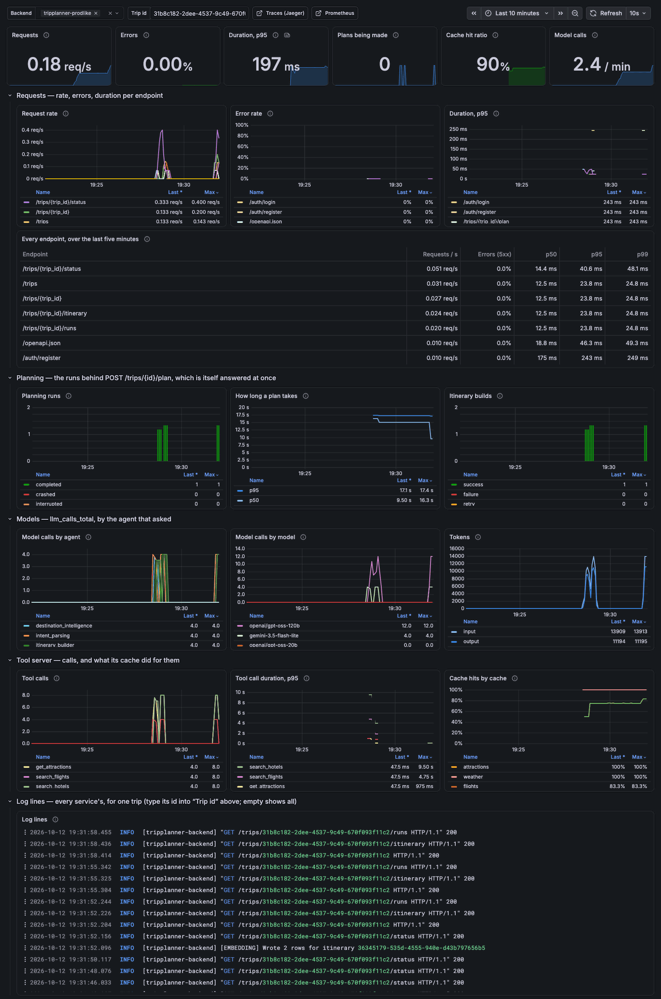

# Phase 29 — Observability: Prometheus, Grafana & OpenTelemetry

**Status: built, and verified end to end on this machine — the production-like stack of Phase 27 with Prometheus, Grafana, Jaeger, Loki and Alloy beside it, planning real trips on real providers and models. NOT on a deployment: there is none yet (Phase 27's is still waiting for its accounts).** What that leaves open is in [Known limits](#known-limits).
**What the phase delivers (roadmap):** RED metrics dashboard live. One planning request produces a single connected trace from API entry to DB write. Log lines searchable by `trip_id`.

Decisions: `DECISIONS.md` #221–#239.

Four things are worth knowing before reading on.

- **Everything the roadmap asks for was seen working, by a script that can say no.** `python scripts/observability_check.py --prodlike` plans a real trip and then asks the four programs what they saw of it: 45 expectations, all met — among them one trace of some 106 spans across two processes with no span missing its parent, the trip's log lines from both services found by its id, and every one of the dashboard's 20 panels showing data. The script's own trace check is tested against nine broken traces.
- **The stack found something nobody had asked it about.** One of the plans it watched took 26.7 s instead of the usual 11 to 15. The trace says why at a glance: `intent_parsing` 15.9 s — the Gemini call ran into its 15-second deadline (`504 DEADLINE_EXCEEDED`) and Groq's small model answered in 0.6 s — and the metric says the same: `llm_calls_total{agent="intent_parsing", model="gemini-3.5-flash-lite", status="error"} 1`. Under [Live results](#what-the-stack-showed-without-being-asked).
- **Two things in the roadmap's wording were not done as written, and one was added.** The library's one-liner `Instrumentator().instrument(app).expose(app)` breaks as soon as a process has two app objects (#224); Grafana's Jaeger data source cannot read Jaeger 2.22, so a log line links to Jaeger's own page (#236). Added: a duration metric for the planning *run* — the request that starts one is answered in 5 ms, so its own duration says nothing (#228).
- **Traces and stored log lines are scrubbed like error reports.** An event stream's address ends in `?token=<the login token>`, and the tracing library records addresses (#233).

## What was built

```
src/telemetry/                          ← NEW: used by both processes, importing neither
  context.py                              two context variables: which trip, whose — set once, read by everything
  metrics.py                              the app's own Prometheus metrics; requests counted per endpoint
  traces.py                               OpenTelemetry: spans, the sampler, the scrubbing exporter, the trace
                                          carried to another process
  logs.py                                 every log line a JSON object with trip_id, user_id, trace_id
src/backend/app/main.py                 ← logging set up as the module loads; RequestContext middleware (the trip
                                          from the address, the user from the token); GET /metrics; tracing on/off
src/backend/app/api/deps.py             ← may_read_metrics: open in development, the operations token in production
src/backend/app/api/routes/trips.py     ← a planning run: one span, timed, counted by how it ended
src/backend/app/db/session.py, redis.py ← every SQL statement and every Redis command a span
src/backend/app/preflight.py            ← says when a deployment sends no traces or cannot be scraped
src/backend/app/core/error_reporting.py ← a tracing backend's key (OTEL_EXPORTER_OTLP_HEADERS) is a secret like the others
src/backend/app/core/config.py          ← LOG_FORMAT, OTEL_EXPORTER_OTLP_ENDPOINT / _HEADERS, OTEL_TRACES_SAMPLE_RATIO
src/ai/usage.py                         ← the model-call handler of Phase 26 also counts each call and makes it a span
src/ai/utils/run_logger.py              ← timed_run("flight_agent"): the agent's name → its span, its model calls
src/ai/llm.py                           ← ASKED_BY: who asks which model, so each counter exists at zero
src/ai/orchestrator/orchestrator.py     ← itinerary_builds_total; the itinerary's pieces published, not recorded
src/ai/mcp_client/client.py             ← a tool call: a span, counted, timed; the trace and the trip sent with it;
                                          the cache's tally heard
src/ai/mcp_server/server.py             ← the call continued as a span of the caller's trace; logs under the
                                          caller's trip; the cache's tally sent back; its own logging and tracing
src/ai/mcp_server/cache.py, outbound.py ← lookups tallied per call; a request to a provider a span (never its address)

docker/observability/                   ← NEW: the stack
  compose.yml                             Prometheus 3.15, Grafana 13.2, Jaeger 2.22, Loki 3.7, Alloy 1.20
  prometheus.yml                          reads the backend on :8000 (development) and :8200 (production-like, token)
  config.alloy                            container and file log lines → Loki; which fields are labels
  grafana/                                two data sources; the dashboard, as a file
scripts/observability.py                ← NEW: up / down / ps / logs
scripts/observability_check.py          ← NEW: plans a trip, asks Prometheus, Jaeger, Loki and Grafana — 45 expectations
docker/prodlike/compose.yml             ← PRODLIKE_OTLP_ENDPOINT → where the stand-in deployment sends its traces
requirements.txt, constraints.txt       ← 8 requirements, 18 new pins
.env.example                            ← the four settings, documented
tests/conftest.py, tests/fakes.py       ← the suites log as text and send no traces whatever .env says; a `spans`
                                          fixture; the in-memory tool server hears the cache's reports
docs/phase29_dashboard.png              ← the dashboard, as it looked
```

## The three signals, and the one id

```
a request ──► RequestContext (middleware)            trip_id ← /trips/<id>/…      user_id ← the login token
                 │   two context variables; every task the request starts begins with a copy
                 ├──► log lines     a filter on the one handler adds trip_id, user_id, trace_id, span_id
                 ├──► spans         a span processor adds trip.id, user.id to every span, whoever made it
                 └──► tool calls    sent in the call's _meta, with the trace: the tool server sets the same two

            Prometheus ◄── GET /metrics            no ids here: a label per trip would be a series per trip
```

One trip id then finds its log lines (`{job="tripplanner"} | trip_id="…"` in Loki) and its traces (tag `trip.id=…` in Jaeger), whichever process wrote them — and a log line's `trace_id` opens its trace.

## Dev A — Prometheus metrics

| The roadmap asks | What was built | Seen |
|---|---|---|
| `prometheus-fastapi-instrumentator` wired into FastAPI: `Instrumentator().instrument(app).expose(app)` | The library's metrics, middleware and `/metrics` route — but the metrics are made once and handed to each app's middleware: the one-liner makes them per app, and a second app object in a process fails with `DuplicateTimeseries` (#224). Endpoints by the router's name; duration to the first byte; `/metrics` behind the operations token in production (#223) | `http_requests_total{handler="/trips/{trip_id}/plan",method="POST",status="2xx"}`; 10 endpoints, none with an id in its name; an event stream open 4 s counted as 5 ms; 404 without the token on the production-like stack |
| Custom: `llm_calls_total` (counter, by agent and model) | Counted in the LangChain handler every model call already passes; `status` (ok / error) added for Phase 34's alert; tokens and list-price cost beside it (#225) | `intent_parsing → gemini-3.5-flash-lite`, `itinerary_builder → openai/gpt-oss-120b`, … and one `status="error"` that was real |
| `mcp_cache_hit_ratio` (gauge) | Hits ÷ lookups over five minutes, NaN when idle; made of `mcp_cache_lookups_total{cache, result}`, which the tool server tallies per call and sends back with the answer — the cache is in one process, the metrics in the other (#226) | 0.50 after one warm-and-plan: flights, hotels, attractions each one miss (warming) and one hit (planning) |
| `itinerary_builds_total` (counter, by status: success / failure / retry) | Counted where each fate is decided; success only once the plan is saved (#227) | `success 1, failure 0, retry 0` — all three there from the start |
| — | `planning_run_duration_seconds{kind, outcome}`, `planning_runs_in_progress`: the run, not the request that started it (#228). `mcp_tool_calls_total`, `mcp_tool_call_duration_seconds`. `tripplanner_build_info{version, commit}` | `plan / completed: 26.7 s`; request 5 ms |
| **Acceptance:** Grafana dashboard shows live request rate / error rate / duration per endpoint. Custom LLM and cache metrics visible | One dashboard, provisioned from a file: six headline numbers; rate, errors, duration per endpoint as charts and as a table; planning; models; tool server and cache; a trip's log lines (#237) | 20 of 20 panels with data after one planned trip; looked at in a browser (below) |

## Dev B — OpenTelemetry tracing & structured logging

| The roadmap asks | What was built | Seen |
|---|---|---|
| `opentelemetry-instrumentation-fastapi` and `-sqlalchemy`; Jaeger or Zipkin backend | Both, and `-redis` (the acceptance names Redis); Jaeger 2, taking OTLP over HTTP directly — no collector between (#230, #236) | services `tripplanner-backend` and `tripplanner-mcp` in Jaeger |
| `trip_id` injected as a span attribute at FastAPI middleware level | `RequestContext`: the trip from the address, the user from the token → two context variables → `trip.id` and `user.id` on the request's span and on every span under it (#221) | `trip.id` on all 107 spans of the plan's trace |
| every downstream call (DB, Redis, MCP) inherits the trace | DB and Redis by the libraries' instrumentation; the planning run by starting inside the request; the tool server — another process — by `traceparent` in the call's `_meta` (#231) | 65 SQL statements, 17 Redis commands (14 + 3 in the tool server), 3 tool calls answered as children of the 3 sent |
| Structured logging: `python-json-logger`; `trip_id` and `user_id` on every log line via `logging.Filter` reading from `contextvars` | `logs.JsonLines` + `logs.ContextFilter`, on the process's one handler; also `trace_id`, `span_id`, `service`; the tool server the same, to standard error (#234) | every line of both processes parses as JSON; the two ids on every line, `null` where the work is nobody's |
| **Acceptance:** one planning request produces a single connected trace spanning FastAPI → SQLAlchemy → Redis → MCP | — | one root (`POST /trips/{trip_id}/plan`), 107 spans, both processes, down to `INSERT INTO itineraries` under `persist` |
| Searching by `trip_id` in the logging UI returns log lines from every service touched | Loki, through Alloy; `trip_id` as structured metadata, not a label (#235); the dashboard's last panel takes a trip id | 43 lines: 34 from the backend, 9 from the tool server |
| No orphaned spans | A sampler drops health checks whole (their queries with them); startup's queries under one span; the session to the tool server made in nobody's context (#231, #232) | every span's parent is in the trace — checked on real Jaeger, and in the integration tests |

## Found and fixed along the way

**A counter's first increment is invisible.** The first run of the check failed three expectations for one reason: after the first plan the "Planning runs" panel was empty, and a request rate could be asked for one endpoint of ten. Prometheus cannot see a counter go from "not there" to 1 — `rate()` starts at the second event. On a quiet system that is the first plan after every restart, and the first error. Every series that can be listed now exists at zero from the start (#229).

**The library's one-liner fails the second app.** `Instrumentator().instrument(app)` registers its metrics when an app's middleware is built. The test suite imports the app under two names, which is two app objects: 47 tests failed with `DuplicateTimeseries`. The metrics are made once and handed in (#224).

**Grafana 13 cannot read Jaeger 2.22.** Its Jaeger data source asks for `/api/services` and `/api/traces?service=…`; Jaeger 2.22 answers 404 to both (it serves `/api/v3`). The data source's own health check says "request failed: 404 Not Found". It is not set up; a log line's `trace_id` links to Jaeger's page for the trace (#236).

**The login token was in the trace.** An event stream is opened as `GET /trips/<id>/stream?token=<the login token>`, and the request instrumentation records the whole address as `http.url`. So does a failed call to a provider: its error message has the address, key included. Every span now goes through Phase 27's scrubber before it is exported, and a request's span leaves without the client's address (#233). Seen on Jaeger: `…/stream?token=[Filtered]`, and the token nowhere in what Jaeger holds for the trip.

**The tool server's session would have belonged to the first trip for ever.** The session is made by whichever request needs it first, and its reader tasks live as long as the process — with a copy of that request's context. Every log line they wrote afterwards would have carried that first trip's id and trace. It is made in nobody's context (#231).

**"Off" was not off after a test had turned tracing on.** A process sets its tracer provider once; what listens to it changes. With nobody listening, spans were still recorded, and a tool call still carried a `traceparent` — which an older test, asserting exactly what is sent with a call, only noticed when it ran after a newer one. With nobody listening nothing is recorded, no log line is given a trace id, and nothing is sent with a call (#238).

**Lines that were not JSON.** Python's own warnings bypass logging: a library's "this model name is about to change" was two lines of bare text in a log of objects. They are taken into the log. The tool server's logging is now set up before its server object is made, for the same reason.

**The tool server's log lines went to the standard error of import time.** The MCP client's `errlog` defaults to `sys.stderr` as it was when the library was imported. It is handed the one in force when the server is started.

**A plan's duration was shown as 12.5 s when it took 10.5.** A histogram places a value somewhere in its bucket, and the buckets around a typical plan were 10 and 15. They are 2.5 s apart there now.

**Zero errors read as "no data".** `sum(rate(5xx)) / sum(rate(all))` has no result when no request failed. The tile said "no requests" on a system with requests. `or vector(0)`.

**In development, nine log lines in ten were SQL.** The engine echoes every statement where `APP_ENV` is development — fine on a console, and 191 of one plan's 215 lines in a log store. In JSON the echo is left out: a statement is a span there. It took a filter on the handler; a level on the logger does nothing, because the engine's echo writes past its logger's level (the first attempt, and a test that had passed without testing it).

**The check wanted a cache miss.** Run twice within a few minutes, the second trip to the same place is answered from the cache whole, and "there was a hit and a miss" failed on a system that was working better than expected. It asks for a hit.

**The check could walk a broken trace for ever.** Its own test fed it a trace with a cycle; climbing to a span's ancestors did not end. It climbs each span once.

Two that were mine, and not the code's:

- **I stopped Docker Desktop twice.** `lsof -ti tcp:8000 | xargs kill`, to stop the backend, lists every process with a socket on that port — and once Prometheus (in Docker) reads the host's port 8000, Docker Desktop's own process is one of them. Every container went down, twice, before I saw why. `HOW_TO_RUN.md` says `-sTCP:LISTEN`.
- **A test of mine only passed with my `.env`.** It expected the model's name as my `.env` gives it, not as the code's default does — so it would have failed in CI. Found by the break-on-purpose baseline, which runs on a copy with no `.env`; the suites were then run whole on such a copy (1,094 passed), and by the local runner in a clean container.
- **A test of mine called the real Groq model three times.** It imported the model class before the stand-in was put behind its name. About 500 tokens; fixed by naming the class through its module inside the block. Nothing else in the suites reaches a provider — checked by running all of them on a copy with no `.env`.

## Live results (the production-like stack, 2026-10-12)

The image that is deployed (`APP_ENV=production`, TLS-only Postgres behind a pooler, TLS-only Redis, Sentry on), rebuilt from this tree, started with `PRODLIKE_OTLP_ENDPOINT=http://host.docker.internal:4318`; real providers and models.

### `python scripts/observability_check.py --prodlike` — 45 passed, 0 failed

```
1. The stack answers
  ✓ Prometheus at http://localhost:9090  — HTTP 200
  ✓ Jaeger at localhost:16686  — HTTP 200
  ✓ Loki at localhost:3110  — HTTP 200
  ✓ Grafana at localhost:3001  — HTTP 200

2. The backend shows its metrics, and Prometheus reads them  (http://localhost:8200)
  ✓ GET /metrics answers in Prometheus's format — to the operations token  — HTTP 200, 604 lines
  ✓ …and to nobody without it  — HTTP 404 without the token
  ✓ it is not one of the API's documented routes
  ✓ Prometheus's target for it is up  — job tripplanner-prodlike, read every 5s

3. A trip is planned
  ✓ an account is made  — HTTP 201
  ✓ a trip is created  — HTTP 201
  ✓ POST /plan answers at once  — HTTP 202
  ✓ the plan is made  — 26.6 s

4. Prometheus: rate, errors and duration per endpoint; the models, the cache, the builds  (instance host.docker.internal:8200)
  ✓ requests are counted per endpoint, as the router names it  — http_requests_total{handler="/trips/{trip_id}/plan", method="POST", status="2xx"}
  ✓ no endpoint's name has an id in it  — 10 endpoints
  ✓ failed requests are counted by class — the two that were made to fail  — 4xx at /trips/{trip_id}: 2
  ✓ a request rate per endpoint can be asked for  — 5 endpoints with traffic in the last 5 min
  ✓ a duration per endpoint can be asked for  — /trips/{trip_id}/status p95 44 ms, /trips/{trip_id}/itinerary p95 24 ms, /trips p95 24 ms
  ✓ llm_calls_total, by agent and model  — intent_parsing → gemini-3.5-flash-lite: 1; intent_parsing → openai/gpt-oss-20b: 1; …
  ✓ mcp_cache_hit_ratio is a ratio  — 0.50 over the last five minutes
  ✓ …made of the tool server's lookups, counted in the backend  — attractions: {'hit': 1, 'miss': 1, 'error': 0}; flights: {'hit': 1, 'miss': 1, 'error': 0}; geocode: {'hit': 1, 'miss': 0, 'error': 0}; hotels: {'hit': 1, 'miss': 1, 'error': 0}; weather: {'hit': 0, 'miss': 1, 'error': 0}
  ✓ itinerary_builds_total, by status  — failure 0, retry 0, success 1
  ✓ the run itself is timed — the request that started it was answered at once  — plan/completed: 26.7 s in all
  ✓ calls to the tool server are counted by tool  — estimate_budget 0, get_attractions 2, get_weather 1, search_flights 2, search_hotels 2

5. Jaeger: one connected trace, from the request to the row
  ✓ the request that asked for the plan is the root of a trace, found by the trip's id
  ✓ it has one root: POST /trips/{trip_id}/plan  — 107 spans in trace a5ae52e3a90de584b9d2ff64cf460c6b
  ✓ no orphaned spans: every span's parent is in the trace
  ✓ it spans both processes  — tripplanner-backend 101, tripplanner-mcp 6
  ✓ FastAPI: the request  — 1 span(s), e.g. 'POST /trips/{trip_id}/plan'
  ✓ SQLAlchemy: its statements  — 65 statements
  ✓ Redis: its commands — in both processes  — tripplanner-backend 14, tripplanner-mcp 3
  ✓ MCP: each call the tool server answered is the child of the call the backend made  — 3 calls sent, 3 answered in tripplanner-mcp
  ✓ the models: each call a span  — llm gemini-3.5-flash-lite, llm openai/gpt-oss-120b, llm openai/gpt-oss-20b
  ✓ the run is the request's child, and outlives it  — request 5 ms, run 26.7 s
  ✓ …down to the row: INSERT INTO itineraries, under the span that saves the plan  — persist → INSERT
  ✓ every span carries the trip's id  — trip.id on all 107
  ✓ nothing Jaeger holds for the trip has the login token in it

6. Loki: the trip's log lines, from every service
     {job="tripplanner"} | trip_id="77bd4592-950c-4239-bd27-0272fb51b327"
  ✓ searching by trip_id finds its lines  — 43 lines
  ✓ from every service the plan touched  — tripplanner-backend 34, tripplanner-mcp 9
  ✓ every one of them carries the user's id too — but the request made without a login  — 42 with the user's id, 1 with none (the 401)
  ✓ and the trace it belongs to: the plan's trace id is on lines of both services  — 8 lines with trace_id a5ae52e3a90de584b9d2ff64cf460c6b
  ✓ every line is one JSON object
  ✓ none has the login token in it

7. Grafana: the dashboard, and what each panel is answered
  ✓ “TripPlanner — requests, plans, models, tools” is provisioned  — 20 panels — http://localhost:3001/d/tripplanner
  ✓ every panel's query is answered without an error
  ✓ the panels a planned trip fills have data  — 20 of 20 panels show data

45 passed, 0 failed
```

That listing is the run in which Gemini did not answer (below). The stack was then rebuilt from the tree as it is committed and the script run again: **45 passed, 0 failed** — a plan in 14.4 s, one trace of 106 spans (100 + 6), 27 + 8 log lines, 20 of 20 panels with data.

The same script against a backend run on the host, started word for word as `HOW_TO_RUN.md` Step 27 B says (`uvicorn` on :8000, its lines written to `./logs` for Alloy to read): **44 passed, 0 failed** — one expectation fewer, because with no operations token there is no "closed without it" to ask; a plan in 14.4 s, 106 spans, 27 + 8 log lines for the trip, and every line of the file one JSON object. That script's first run, the day before, was 41 of 44: three of the findings above.

And with Jaeger stopped (`docker stop tripplanner-observability-jaeger-1`), a plan was made in the same 12.4 s. The exporter said so in the log — 15 warnings and 4 errors over that plan, from both services ("Transient error … encountered while exporting span batch") — and nothing else changed: what watches the app is not in its path.

### What the stack showed without being asked

The plan of the run listed above took 26.7 s; the ones before and after it took 10 to 16. Its trace, as Jaeger has it (statements and commands left out):

```
POST /trips/{trip_id}/plan                              5 ms   backend    answered 202
  planning run                                     26,748 ms   backend
    orchestrator                                   26,737 ms
      intent_parsing                               15,855 ms              ← here
        llm gemini-3.5-flash-lite                  15,182 ms   ERROR      504 DEADLINE_EXCEEDED: "Deadline expired before
        llm openai/gpt-oss-20b                        605 ms              operation could complete" — then the stand-in model
      flight_agent                                     17 ms
        mcp.call search_flights                        15 ms
          tools/call search_flights                     2 ms   mcp        from the cache: warmed when the trip was created
      hotel_agent                                      18 ms
        mcp.call search_hotels                          7 ms
          tools/call search_hotels                      1 ms   mcp
      activities_agent                                661 ms
        mcp.call get_attractions                      651 ms
          tools/call get_attractions                  638 ms   mcp
      destination_intelligence                      1,341 ms
        llm openai/gpt-oss-120b                     1,333 ms
      itinerary_builder                             8,398 ms
        llm openai/gpt-oss-120b                     8,386 ms
      evaluator                                         0 ms
      persist                                           7 ms              INSERT INTO itineraries · UPDATE trips
      preference_extractor                          1,026 ms
        llm openai/gpt-oss-120b                     1,015 ms
```

and in Prometheus: `llm_calls_total{agent="intent_parsing", model="gemini-3.5-flash-lite", status="error"} 1` beside `…status="ok"} 1` from the run before. Nothing was broken on purpose: Gemini did not answer within the 15 seconds a short prompt is given (`src/ai/llm.py`), and the fallback of Phase 20 did its job — at a cost of 15 seconds that, before this phase, would have been a plan that "felt slow" and nothing more.

### The request that creates a trip

`POST /trips` is answered in 12 ms and leaves the cache warming behind — which is where the providers are asked, and where the tool server's half of a trace is largest (20 of 32 spans):

```
POST /trips                                            12 ms   backend
  mcp.call search_flights                           7,325 ms
    tools/call search_flights                       6,930 ms   mcp
      GET                                               1 ms              the cache: a miss
      provider duffel                               6,854 ms              the provider's name, the status, the attempts —
      SET                                               1 ms              never the address
  mcp.call search_hotels                            7,904 ms
    tools/call search_hotels                        7,519 ms   mcp
      provider liteapi                              7,420 ms
  mcp.call get_attractions                          6,093 ms
    tools/call get_attractions                      5,702 ms   mcp
      provider nominatim                            2,059 ms
      provider opentripmap  (×3)                    2,122 · 711 · 731 ms
```

### An event stream

Opened as a browser opens it, with the token in the address, and held for 4 s:

```
span          GET /trips/{trip_id}/stream | 4.0 s     http.url: http://localhost:8000/trips/04f5…/stream?token=[Filtered]
              user.id set, no client address; the login token nowhere in what Jaeger holds for the trip
metric        http_request_duration_seconds_sum{handler="/trips/{trip_id}/stream"} 0.0052     (to its first byte)
              http_requests_inprogress{handler="/trips/{trip_id}/stream"} 1 while it was open, 0 after
log line      "GET /trips/04f5…/stream?token=[Filtered] HTTP/1.1" 200      no client address
```

### The dashboard, in a browser



Rendered headless at 1600 px and read (the picture is that render, after the last changes). Top row: `0.03 req/s · 0.00 % · 37.5 ms · 0 · 38 % · 0.8 / min`. The per-endpoint table: five rows — `/trips/{trip_id}/status 0.014 req/s, 0.0 %, 16.7 / 45 / 49 ms`, … — and none for endpoints nobody asked. Planning: one green bar, "completed". The last panel, with a trip id typed in: its lines from both services, newest first, each opening to its `trip_id`, `user_id`, `trace_id` and a link to the trace. What was changed after looking: the two error panels (above), idle endpoints as rows of NaN, legends sorted busiest first, the service's name at the start of each log line, "/ min" on the model-call tile.

### Phase 27's check, on the same image

`python scripts/prod_check.py --prodlike`: 25 passed, 0 failed, 1 skipped — every backend check, the deliberate error reaching the Sentry stand-in scrubbed among them, with two more layers around every request. The skipped one is the frontend's four (none was started: nothing of the frontend changed in this phase).

### The pipeline of Phase 28, on this tree

The two jobs that install from `constraints.txt` on Python 3.11 in a clean container with no `.env`, run by the local runner on the workflow files as they are (18 new pins; a test that depended on `.env` was found on the way to this — see below):

```
CI / backend                       exit 0 in 52 s    lint · migrations up, checked, down, up · 1094 passed in 18.31 s
Nightly / integration tests        exit 0 in 45 s    64 passed in 27.75 s → "✅ Nightly, 2026-10-12 — 64 passed" → posted (stand-in)
```

The nightly job's 64 include the test that starts the tool server as a second process and follows a trace into it — on Linux, in the runner's container, as well as here.

## Tests

**1,094 unit + contract, 64 integration, 60 browser — all passing.** New in this phase: 84 unit, 4 integration.

- **`tests/unit/test_phase29_telemetry.py` (30)** — the package on its own. The two context variables: a task started in a request keeps them after the request is over, and nothing is left behind. A log line: its fields and their order, `null` ids outside a request, a secret taken out of a message and a traceback, an access line's parts and no client address, answered health checks dropped and failed ones kept, the whole process as JSON whoever logged (the web server, a library at WARNING only, Python's warnings). Spans: parent and child, an error marked, `trip.id` on a span some library made, a trace carried across as one line of text, a block that belongs to no trace, health checks dropped under both attribute names, everything scrubbed on export and an unscrubbable span not sent, on only with an endpoint and never in a test stack, off meaning off. Metrics: the five-minute window on a clock that is moved by hand, each counter, a run's four outcomes, every listable series at zero. A FastAPI app: counted by the router's names with no id anywhere, a stream timed to its first byte and counted as in progress, a caller's trace continued.
- **`tests/unit/test_phase29_wiring.py` (31)** — the app's use of it. The trip read from the address and the user from the token (and a forged token naming nobody); the order of the layers; `/metrics` open, closed, and behind the token in its two forms; a new trip named for what POST /trips starts; a run as one span under its request with its four outcomes counted; an agent's name as a span; a model call counted for the agent that asked, with tokens and list price, streamed once, failed as an error; a whole plan's spans from the run to the models, and everyone who asked on the list; a build counted by its fate — and not as a success when the commit fails; the itinerary's pieces published unrecorded. The tool server through the real server object and the real client: the trace and the trip carried across, the cache's tally carried back (miss, then hit, then error with Redis gone), a line logged in a worker thread carrying the caller's trip, an error answer failing both spans, the session made in nobody's context; a request to a provider as a span that never holds its address. The pre-start check's new warnings.
- **`tests/unit/test_phase29_stack.py` (23)** — the files only other programs read. Images pinned; ports that do not collide with the app's, the tests' or the production-like stack's; Prometheus's two targets and the token for one; the token file made from the production-like stack's and git-ignored; which log fields are labels and which are not; two data sources and no third; **every metric a panel asks for is one the app exports**; the roadmap's panels; no dual axis, a unit on every number, state colours for states only. And the check script against a whole trace and nine broken ones — an orphan, one process missing, the tool server starting its own trace, no row written, a span untagged, the token in an attribute, …: it says no to each.
- **`tests/integration/test_phase29_observability_integration.py` (4)** — real Postgres, real Redis. A planning request through the HTTP API is one trace to the itinerary's INSERT with no orphan, SQL recorded without values and Redis without arguments, the builder's pieces published and not spans. A health check answered and no span made. A second engine reports its statements. And **the tool server started as it is in production — `python -m src.ai.mcp_server.server`, a process of its own, over its pipes** — with its spans sent to a collector inside the test: the call answered there is the child of the call sent here, its cache lookup under it, the caller's trip on both, its log lines on standard error carrying the trip and the trace, and the cache's hit counted in this process.

### Break it on purpose

170 deliberate breakages, each applied to a scratch copy of the repository with a database of its own; the Phase 29 unit tests run on it, and the integration tests when the unit tests let it through. **160 caught on the first pass — 6 of them only by the integration tests; all 170 after four tests were added and six breakages re-written** (their text had not matched the formatted source).

The four that survived the first pass, and what was missing:

| The breakage | Why nothing failed | Now |
|---|---|---|
| libraries heard at INFO (an HTTP client's "GET https://…?key=…" lines in the log) | the test logged as `httpx` — whose level another module had already raised, so the line was dropped either way | a logger nobody else has touched |
| spans sent unscrubbed | the test checked what kind of processor was listening, not what reached the exporter | a span is sent through the configured pipeline and read at the exporter |
| a client span's peer dropped as if it were a person's address | the test's attribute was not one of the names that are dropped | one that is |
| the model that *answered* in the label, not the one asked for | every stand-in model answered under the name it was asked by | one that answers under a dated name, as the providers do |

The six only the integration tests caught are the ones that need the real thing: an engine's statements and a Redis client's commands not being spans (real servers), and four in the tool server — its log written to standard output (which is its protocol: the client could not parse it), its spans under the backend's name, its tracing never set up, its cache's commands not spans — which need the tool server to be a process of its own.

| Where | Breakages | For example |
|---|---|---|
| `context.py` | 4 | a scope leaving the trip behind · the span under way not told |
| `logs.py` | 19 | no trip on a line · nothing scrubbed · the client's address kept · failed health checks dropped too · text by default in production · a second handler each time |
| `traces.py` | 24 | health checks traced · recorded while nobody listens · on in the test stacks · sent unscrubbed · an unscrubbable span sent as it was · a span per event of a stream |
| `metrics.py` | 19 | a ratio of nothing as zero · a failed lookup left out of the ratio · a crash counted as completed · `/metrics` without its guard · a stream timed until it closes · series not made at zero |
| the app (`main.py`, `deps.py`, `trips.py`, `session.py`, `redis.py`) | 23 | metrics open in production without a token · a forged token naming a user · any path with an id read as a trip · a retry counted as a refinement · a crash not marked on the run's span |
| the planner (`usage.py`, `llm.py`, `run_logger.py`, `orchestrator.py`) | 16 | model calls counted for nobody · a failure not counted · success counted before it is saved · every piece of the itinerary a span |
| the tool call (`client.py`, `server.py`, `cache.py`, `outbound.py`) | 29 | the trace not sent · the trip not sent · the session made in the first request's context · the server starting a trace of its own · the tally not sent · Redis gone not tallied · a provider's status not said |
| the pre-start check | 4 | a bare host as a trace endpoint passing |
| the stack's files | 24 | an image at `latest` · Loki on the browser tests' port · the token sent to the wrong backend · the trip's id as a label · a metric the app does not export · a crash drawn in green |
| the two scripts | 8 | an orphaned span passing the check · one process being enough · a token in a span passing |

## Done criterion checklist

| | Criterion | |
|---|---|---|
| ✅ | Grafana dashboard shows live request rate / error rate / duration per endpoint | the check, section 7, and a browser |
| ✅ | Custom LLM and cache metrics visible | `llm_calls_total`, `mcp_cache_hit_ratio`, `itinerary_builds_total` — in Prometheus and on the dashboard |
| ✅ | One planning request produces a single connected trace spanning FastAPI → SQLAlchemy → Redis → MCP | 107 spans, one root, two processes, to the INSERT |
| ✅ | Searching by `trip_id` in the logging UI returns log lines from every service touched | Loki: 34 + 9 lines |
| ✅ | No orphaned spans | on Jaeger, and in the integration tests |
| ◻ | …on a deployment | there is none: the production-like stack on one machine (#239) |

✅ seen on the production-like stack · ◻ not possible yet

## Known limits

- **Not on a deployment.** In production the trace backend is somebody's service (the same two settings: an address, and a header for its key), the platform collects the log lines (Railway's log explorer reads JSON and searches by attribute — not tried), and Prometheus must run somewhere that can reach the backend, with the operations token. None of it exists yet; `HOW_TO_RUN.md`, Step 27 D says what to set when it does.
- **Nothing alerts.** A dashboard is looked at. Alert rules are Phase 34 — which should put its "plan is slow" rule on `planning_run_duration_seconds`, not on the request (#228).
- **A trace backend that is down is noisy.** Each batch of spans is tried again for a while and then dropped, with a warning each time — some twenty log lines a plan, from both processes. The app is not slowed; the log is.
- **The stack is for one machine.** No passwords (Grafana is open to whoever reaches port 3001), traces kept in Jaeger's memory and gone with its container, seven days of metrics.
- **An endpoint's first request after a start is not in its rate** (#229): that counter is the library's, and cannot be made at zero for labels it has not seen.
- **`mcp_cache_hit_ratio` is of one process.** With several instances each has its own gauge; the counter beside it adds up correctly, which is why the dashboard's per-cache chart uses the counter.
- **Sampling is all or nothing per request, decided at its start** (`OTEL_TRACES_SAMPLE_RATIO`, default 1). A request that is passed over has no trace id on its log lines.
- **The container's first lines are not JSON.** The pre-start check and the migrations are other programs and write as they always did; Loki keeps their lines under `job="tripplanner"` with no `service`.
- **What the scrubber does not know, it does not remove.** It takes out the deployment's own secrets by value, credentials in URLs, tokens, e-mail addresses. A traveller's name in an itinerary is in no span and no log line here; if a later phase logs one, nothing will stop it.
- **A plan with a Gemini that does not answer waits 15 seconds for it** — seen above. Not changed in this phase; it is a setting of `src/ai/llm.py` and a question for whoever looks at latency next (Phase 30).
