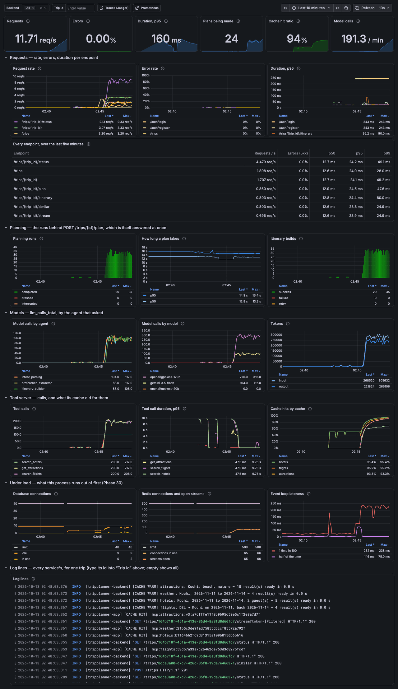

# Phase 30 — Load Testing & Performance Baseline

**Status: done, on one machine.** A baseline was measured before anything was tuned, the bottleneck was found and fixed, and the same load was run again. Everything was measured on **one laptop that ran both the load generator and the system under load**, against **stand-ins for the models and the providers** — the image that is deployed, on the production-like stack of Phase 27. **Not on a deployment: there is none yet** (Phase 27's is still waiting for its accounts), and this load must never be pointed at one.

**What the phase delivers (roadmap):** A documented baseline report exists. Bottleneck identified and fixed, before/after numbers recorded.

The report: [load-test-report.md](load-test-report.md). Decisions: `DECISIONS.md` #240–#257. How to run it: `HOW_TO_RUN.md`, Step 28.

Five things are worth knowing before reading on.

- **Before: 1.3 requests a second at 210 ms p99. After: 43 requests a second at 206 ms p99.** In visits — someone who comes, plans a trip and reads it — one every ten seconds before, 3.2 a second after, every plan made in 13 seconds. At eight times the baseline's limit the stack as Phase 29 left it had a plan taking two minutes and two travellers in three getting none.
- **The bottleneck was database connections, held by plans that were not using them.** Every step of a planning run committed its row and then read — the row back, and after a step that asked a model, what the trip had cost so far; a read opens a transaction, and it stayed open until the next step, through the model call in between. One plan, one connection, for its whole twelve seconds — and the stack had four at its pooler. The processor never passed a sixth of one core.
- **The guess this phase started with was wrong, and the report says so.** "The pool runs out at around 15 concurrent plans": the wall was at 4, at the pooler, and the app's pool of 15 filled as a consequence. The hypothesis the change was made on was written down before the change, with what it predicted and what would show it wrong; so were the two that followed.
- **Three changes, each told apart from the others by a run of its own.** The configuration alone (the pooler lends 90, the app's pool is a setting: 40) — sixteen times the visits. The code alone, on the baseline's own 4 + 15 connections — the rates that had broken the baseline hold. And the Redis library's limit of 100 connections, which the first wall had been hiding, made a setting.
- **Nothing was changed that was not measured.** No worker processes: the processor was the last thing to run out, not the first. The password check that now takes half of one process's core is in the report as the next finding, with the number that would prove it — not slipped in.

## What was built

```
loadtest/                               ← NEW: what loads the app, and what stands in for the world outside it
  k6/traveller.js                         one visit, as the trip page makes it: sign in (half of them), the trips
                                          list, create, the page and its event stream, POST /plan, /status every 3 s,
                                          then the itinerary, the trip, similar trips — and the page left open
  standins/                               the models, the embedding API and the five providers, stood in for —
    timing.py                               each taking as long as the real one was measured to
    models.py                               a chat model that answers through LangChain (so tokens are metered and
                                            the call is counted and a span), streams at a model's pace; an embedding
    providers.py                            httpx.get / httpx.post inside the tool server: Duffel, LiteAPI,
                                            OpenTripMap, OpenWeather, Nominatim — twelve destinations
    seams.py                                where each is put in: four names, and nothing nearer the app than that
    guard.py                                refuses a database or a Redis that is not on this machine
    app.py                                  what the load test's image serves: the guard, the stand-ins, then the app
    tool_server.py                          the tool server's process: the guard, the providers, then the real one
docker/loadtest/
  Dockerfile                            ← the deployed image, FROM it, with loadtest/standins added and one word
                                          of the command changed
  compose.yml                           ← laid over docker/prodlike/compose.yml: that image, placeholder keys,
                                          one request in ten traced
  small-pools.yml                       ← the baseline's connections put back: 4 at the pooler, 5 + 10 in the app
scripts/loadtest.py                     ← k6 (builds it), up / down, smoke, one-plan, run, ladder, table — and while
                                          k6 loads the stack, what the pooler, Postgres, /metrics and Docker say
docs/load-test-report.md                ← the report
docs/loadtest/                          ← every run it is made of, as it was measured

src/ai/utils/run_logger.py              ← a logged row is not read back; hand_back(): end a read's transaction
                                          before a wait
src/ai/orchestrator/orchestrator.py     ← two lookups hand the connection back before a model is asked
src/backend/app/api/routes/trips.py     ← search and POST /refine do the same
src/ai/embeddings/embedder.py           ← the vectors first, then one transaction for the rows
src/ai/utils/embeddings.py              ← the job's two reads end before the embedding API is asked
src/backend/app/core/config.py          ← DB_POOL_SIZE, DB_MAX_OVERFLOW, REDIS_MAX_CONNECTIONS
src/backend/app/db/session.py, redis.py ← the pools made from them, and reported
src/telemetry/metrics.py                ← db_pool_connections, redis_pool_connections (each with its limit),
                                          event_loop_lag_seconds
src/backend/app/main.py                 ← the event loop watched for as long as the app serves
docker/prodlike/pgbouncer.ini           ← default_pool_size 90 (was 4); the stack's user may ask SHOW POOLS
docker/prodlike/compose.yml             ← the pool 10 + 30, Redis 500
docker/observability/grafana/dashboards/tripplanner.json
                                        ← a row "Under load": the two pools against their limits, the event loop
.env.example                            ← the three settings, and what to set them to
```

## Dev A — load test scripts and the baseline

**k6 was checked for before anything was planned around it:** not installed. And k6 as shipped cannot do the job: `http.get` on an event stream waits for a response that never ends. The `xk6-sse` extension reads streams; its README says k6 resolves it by itself, and k6's build service answered "unknown dependency" — so `scripts/loadtest.py k6` builds k6 v2.3.0 with it in the `grafana/xk6` image — nothing else to install — pinned, into a git-ignored directory. Three things about the extension are in the script because they were found by trying: no timer fires while a stream is open; an event's name keeps the `\r` of this server's line endings; a stream's whole life is reported as a request's duration, so streams are tagged apart and the latency figures are of everything else.

**"Staging" is the production-like stack, and what answers for the models is decided before the script.** The models and the providers cannot take load (about twenty Gemini requests a day; sandboxes), so stand-ins answer — and "it must be impossible to switch on in a real deployment by accident" was taken literally: there is no switch. They are a different program, outside `src/`, in a second image built `FROM` the deployed one; that program refuses a database or a Redis that is not on this machine; and the stack is given placeholder keys and never the repository's `.env`. A test holds each of the four (#240). Each stand-in takes as long as the real thing was measured to (#242), and one plan was made on real providers and models for this phase and compared, span for span, with the same plan by the stand-ins (the report, section 2).

**The load is visits at a fixed rate**, not a fixed number of users — users who each wait for their answer slow down with the server and report a slow server as a quiet one (#244). A visit is the roadmap's four endpoints and the six the page asks around them. How long a plan takes is a metric of its own, from `POST /plan` to `planning_complete` on the stream (#245), and what "holds" means was written down before anything was measured.

**Watched live, and by the runner.** Grafana was open on the dashboard; a dashboard is looked at, though, and a report needs numbers that were kept — so every two seconds the runner asks the pooler who is waiting, Postgres what its connections are doing, the backend its own `/metrics`, and Docker its memory (#247). Three gauges were added to the app for this before the baseline (#249): the two pools against their limits, and how late the event loop runs.

**The baseline** — the stack as Phase 29 left it, commit `33e3f94`:

| Visits a second | Plans made | A plan takes, p50 / p95 | Requests a second | Request p50 / p95 / p99 | Failed | Holds |
|---|---|---|---|---|---|---|
| 0.1 | 19 of 19 | 11.3 s / 13.2 s | 1.3 | 9 ms / 21 ms / 210 ms | 0.0% | yes |
| 0.2 | 37 of 37 | 11.4 s / 12.3 s | 2.6 | 9 ms / 697 ms / 1,296 ms | 0.0% | no |
| 0.4 | 72 of 73 | 25.2 s / 53.7 s | 7.2 | 1,194 ms / 4,047 ms / 6,430 ms | 0.0% | no |
| 0.8 | 51 of 145 | 127.1 s / 230.0 s | 42.2 | 351 ms / 11,731 ms / 15,810 ms | 0.0% | no |

## Dev B — the bottleneck, the hypothesis, the change, the re-run

In the order it happened; the times are the result files' and the working session's own record.

| When (IST, 13 October) | What |
|---|---|
| 12 Oct, 21:29 | Written before any load: what one plan does to the database (a connection idle in a transaction for 8 of its 12.6 s), and four predictions — among them the guess the phase began with, *the pool runs out at around 15 concurrent plans* |
| 00:30–00:48 | **The baseline.** Holds 0.1 visits a second; at 0.8, 51 of 145 visits get a plan |
| 00:51 | **The hypothesis, written down:** the number of plans the stack can make at once is the number of connections it can hold open — 4 at the pooler ÷ 14 connection-seconds a plan ≈ 0.3 plans a second. Predicted: with 90 and 40 connections and nothing else changed, 0.2 to 1.6 hold and 3.2 does not, for want of Redis connections |
| 00:52 | **The configuration change:** `default_pool_size` 4 → 90; `DB_POOL_SIZE` / `DB_MAX_OVERFLOW` made settings, 10 + 30 |
| 00:54–01:21 | **Re-run.** Holds 1.6 visits a second — 20.8 requests a second at 199 ms p99; 3.2 fails on Redis: `MaxConnectionsError`, 100 of 100. As predicted, both |
| 01:22 | **Two more hypotheses, written down:** a plan holds a connection only because a transaction is left open between its steps; and the Redis client's limit of 100 is one connection a page |
| 01:24–01:26 | **The code change**, and `REDIS_MAX_CONNECTIONS` |
| 01:32–01:45 | **The code change on the baseline's own 4 + 15 connections:** 0.4, 0.8 and 1.6 hold, 3 of the pooler's 4 connections in use at most |
| 01:48–02:22 | **After, on what is shipped:** holds 3.2 visits a second — 43.0 requests a second at 206 ms p99; fails at 6.4, where one process is out of processor |
| 02:26–02:30 | 1.6 visits a second with every request traced, to say what the one-in-ten sampling was worth |
| 02:45–02:49 | The tree as committed, once more: 1.6 visits a second holds; the dashboard's picture taken during it |
| 02:51–03:03 | **The fix broken on purpose, on a copy:** the read-back alone put back — still holds; `log_agent_run` as it was — the baseline's collapse is back. Which read it was |
| 03:04–03:06 | The production-like stack on real providers and models: Phase 27's check, Phase 29's check, and one plan watched — no connection held |

**How the bottleneck is known**, in one paragraph (the report's section 6 has the tables): at every overloaded rate the pooler's four server connections were all lent and 3.4 of them, on average, were idle inside a transaction; eleven clients waited at the pooler — the rest of the app's pool of fifteen; and the traces of the slow plans show models taking the same 12 to 15 seconds in every one while a 132-second plan spent 123 of them being given a connection, fifteen times. The backend used 0.16 of a core.

**The configuration change made and justified:** 90 at the pooler because that is what the hosted pooler this one stands in for lends (90 % of the database's `max_connections`, 104 on its smallest compute); 40 in the app because two instances are alive during a deploy and both must fit (#252).

**Before and after:**

| | Visits a second it holds | Requests a second | Request p99 | A plan, p95 |
|---|---|---|---|---|
| Before | 0.1 | 1.3 | 210 ms | 13.2 s |
| After the configuration change | 1.6 | 20.8 | 199 ms | 14.0 s |
| After all three changes | 3.2 | 43.0 | 206 ms | 15.4 s |

**Uvicorn workers were not the fix**, so their consequences were not incurred — but they are the next step, and what would be wrong in silence when they are added is written down where the next person will look: the report's section 11, and #256. `/metrics` and its gauges, the tool server's count for each provider's rate limit, and both pools are per process.

## Found and fixed along the way

**The laptop was asleep and nothing said so.** The first smoke run had a 34-second hole in it: a stand-in's 6.5-second wait was logged 41 seconds after it began. The lid was closed, on battery, and macOS slept four seconds in every nine while every program appeared to run; `caffeinate` does not prevent it. The runner now compares the wall clock with the clock programs time by across every run and does not keep one that slept (#248). Timed work waited until the lid was open.

**k6's build service would not build the extension its own README says it builds.** "unknown dependency: k6/x/sse", with and without the community-extensions switch. Built with the `grafana/xk6` image.

**An event's name was never `connected`.** It was `connected\r`: the server ends its lines `\r\n` and the extension splits on `\n`. Nothing failed — the script simply waited for an event that had arrived.

**A thread that could not be stopped.** The runner's watcher kept its stop flag as `_stop`, which `threading.Thread` already has, as a method.

**The stand-ins' catalogue was too thin for the planner.** Five attractions for "beach and nature" where the tools ask for ten: every plan was a plan with a warning. Enlarged until every set of interests the load asks for gets ten.

**A visit that could not start was not counted as offered.** k6 counts an iteration when it starts; one dropped because every virtual user was busy was in no total, so an overloaded rate looked like a smaller one. Offered is now started plus dropped.

**A histogram's last bucket is infinity, and JSON has no infinity.** The event loop's lateness past 2.5 s is written as what is known of it: `">2.5"`.

**The reordered embedding job outlived the tests' cleanup.** With the vectors fetched before the database is touched, the job's write landed during the integration fixture's `TRUNCATE`: a deadlock. The fixture now waits for the app's background tasks, as a shutdown does.

**Three searches share one session.** The test of the invariant found `hotels: True` — a transaction open while the hotel search waited. It was the flight search committing its row at that instant on the run's one session. The waits are looked at a tenth of a second apart; the invariant is about what is *left* open.

**The break-it check as first written was wrong, and said something about the cause.** `HOW_TO_RUN.md` said: put the read-back into `log_agent_run` again and 0.8 visits a second no longer holds on the baseline's pools. Run for real, on a copy: it holds — 10 of 15 connections in use at the worst and five waiting at the pooler for a moment, but every plan on time. The read-back was the smaller half. The function's second read — the trip's cost, added up after every step that asked a model — is what was open through the itinerary's six seconds; with the function as it was, the baseline's collapse is back (118 of 145 plans, eleven waiting at the pooler). Both runs are in the report (section 9) and the break-it line says what happens.

**Clock times in the report were written from memory.** When the report was finished its times were checked against the result files and the session's record: three were minutes out (one hypothesis was stamped eight minutes *after* the run that tested it began). The order was as written — each hypothesis before its change — and the times are now the recorded ones; the report says so.

## Live results

Everything measured is in [load-test-report.md](load-test-report.md) and [loadtest/](loadtest/); this section is what was checked last, on the tree as committed.

### The last run: 1.6 visits a second on the tree as committed

The stack rebuilt from an empty database, the default one request in ten traced, version `0.30.0`
(`docs/loadtest/final/`, 02:45–02:49 IST):

```
── final: 1.6 visits a second for 180 s ──
  visits started 1.6/s for 180 s
  plans: asked 289, completed 289, failed 0, visits dropped 0
  a plan took: p50 11652 ms, p95 13341 ms, max 14730 ms
  requests (not streams): 3698, failed 0.00 %, p50 7 ms, p95 45 ms, p99 197 ms
  the stack: plans in progress up to 25.0, streams 66.0, database pool 5.0/40.0, pooler serving 9 with 0 waiting
  (longest 0 s), backend CPU 0.32 cores, event loop late by 250 ms at p99
  HOLDS   → docs/loadtest/final/rate-1.6.json
```



The row "Under load" is the one above the log lines: 2 database connections in use of 40 while 24
plans are being made; 65 Redis connections for 65 open streams, of 500; the event loop a quarter of
a second late one time in a hundred.

### The fix, broken on purpose under load

On a copy of the repository, on the baseline's 4 + 15 connections, 0.8 visits a second (02:51–03:03):

| `log_agent_run` | Plans made | A plan takes, p50 / p95 | Request p99 | Pool in use, max | Waiting at the pooler, max | |
|---|---|---|---|---|---|---|
| as shipped | 145 of 145 | 11.7 s / 13.8 s | 202 ms | 2 of 15 | 0 | holds |
| the read-back put back | 145 of 145 | 11.7 s / 13.7 s | 209 ms | 10 of 15 | 5 | holds |
| as it was before the phase | 118 of 145 | 58.5 s / 163.6 s | 15,395 ms | 15 of 15 | 11 | does not |

The second row is the one that was expected to fail (see "Found and fixed along the way").

### On real providers and models, the tree as committed

The load test's stack taken down, the production-like stack of Phase 27 brought up in its place — real keys,
the pooler at 90, the pool 10 + 30, Redis 500 — and the two earlier phases' checks run on it:

```
$ docker exec tripplanner-prodlike-backend-1 ls loadtest
ls: cannot access 'loadtest': No such file or directory        ← the stand-ins are not in the image that is deployed
$ curl -s localhost:8200/version          {"version":"0.30.0","commit":null}

$ python scripts/prod_check.py --prodlike
  ✓ the plan arrives over the stream — 12.7 s; 38 events (33 pieces of the itinerary as it was written); ended with 'planning_complete'
  …
25 passed, 0 failed, 1 skipped                                 ← skipped: the frontend (no --web)

$ python scripts/observability_check.py --prodlike
  ✓ every panel's query is answered without an error
  ✓ the panels a planned trip fills have data  — 23 of 23 panels show data
45 passed, 0 failed

$ python scripts/loadtest.py one-plan --api http://localhost:8200 --destination Jaipur
the plan took 8.47 s: 38 events, 33 of them pieces of the itinerary
  intent_parsing             completed    1241 ms  427
  destination_intelligence   completed    1603 ms  951
  itinerary_builder          completed    5295 ms  4331
  preference_extractor       completed    1023 ms  805
  …
Postgres: a connection idle inside a transaction from 0.09 s to 0.09 s after POST /plan
```

That last line read `from 4.8 s` to the end of the plan and beyond when the phase began: now one look
in 23 catches a transaction in passing — the request that asks for the plan — and none after it.

### The machine

Docker Desktop has 8 GB here. The most the containers used together was 2.6 GB, during the overloaded 6.4 step
(the backend alone 1.0 GB, with 438 plans in flight); 1.1 to 1.8 GB at every rate that holds. No run was kept
that the machine slept through — none of the kept ones did.

## Tests

**1,200 unit + contract, 65 integration, 60 browser — all passing.** New in this phase: 106 unit, 1 integration.

- **`tests/unit/test_phase30_standins.py` (38)** — that the stand-ins cannot be a deployment: nothing of them in the deployed image; no setting, flag or variable anywhere in `src/` that mentions them; the load test's image is the deployed one with one directory added and one word of its command changed; the stack is given no real key; a host with a dot in its name is refused, by name, and nothing is stood in for before the guard has said yes. And that they behave as the real things do: the real tools find every trip the load asks for and cache it under the real keys; a request to anywhere else is not sent; a provider is waited for on the thread that asked; a stand-in's plan passes the builder's checks and the evaluator's; its call is metered and counted through LangChain; the itinerary arrives in pieces at a model's pace; every wait lies between the fastest and the slowest the real one took, most often near the usual — and **the report's table of waits is parsed and held to the code's**; a stand-in provider prices a trip for everyone and for every night.
- **`tests/unit/test_phase30_loadtest.py` (36)** — the script and the runner, without a stack: every endpoint the script asks is a route the app has; visits start at a fixed rate; a stream's lifetime is kept out of the latency figures; the stream is opened as a browser opens it; the script and the runner agree on how long a traveller waits; what is built is pinned; no load is put on a stack without the stand-ins, and `up` does not call one ready; the small pools are the baseline's; a ladder stops where the stack fell over; a machine that slept is told from one that did not, and its run is not kept — whether it slept before the load or under it; the pooler's, Postgres's, the backend's and Docker's answers parsed from what they really print; **every number the runner reads is one the app exports**; what "holds" means.
- **`tests/unit/test_phase30_saturation.py` (11)** — the three gauges, read from real pools (SQLAlchemy's and redis-py's own objects, because what they report are those libraries' internals); importing the app is enough for its pool to be reported (asked of a fresh interpreter); a pool that cannot be read is no number and never a failed scrape; the event loop's lateness seen when something blocks it, and not mistaken for the wait itself; the dashboard's row.
- **`tests/unit/test_phase30_tuning.py` (20)** — the engine made with the pool the settings say; someone who sets nothing gets the pool the app always had; a pool of nothing refused; two instances fit in what the pooler lends, and the pooler lends no more than the database has; a logged step ends its transaction and reads nothing back; the four places that read and then wait do so with no connection in hand; the embedding job asks the API before it touches the database again.
- **`tests/integration/test_phase30_connections_integration.py` (1)** — real Postgres, real Redis, a whole plan through the HTTP API: at every wait — three models, the extractor's, three tools, the embedding API — the session of the code that is waiting is not in a transaction; and nothing is left lent when it is over (#254).
- Changed: `test_run_logger.py` (a row is not read back), `test_phase14_embeddings.py` (a failed embedding leaves nothing to roll back; a failed write is rolled back — one test more), the integration fixture (waits for background tasks).

### Break it on purpose

179 deliberate breakages, each applied to a scratch copy of the repository with a database of its own; the Phase 30 unit tests and the two older files the phase touched run on it, then the whole unit and contract suite, then the integration suite, stopping at the first that fails. **154 of 176 caught on the first pass; all 179 after thirteen tests were added and four changed** — and the whole set run again from the start, with three more breakages added (a read put back under another name in each of three places).

The twenty-two that survived the first pass, and what was missing:

| The breakage | Why nothing failed | Now |
|---|---|---|
| the database pool not reported; the Redis pool not reported | the gauges' own tests point them at the app's pools afterwards, to tidy up — which is the very call that had been removed | a fresh interpreter is asked what importing the app reports; the Redis test points the gauges at nothing first |
| the event loop's lateness counted from when the wait began | with a 10 ms wait, "10 ms late" was still under the 50 ms the test allowed | asked to wake in 50 ms, it must report under 25 |
| a database URL that cannot be read, accepted by the guard | the test's list had none | one with half an IPv6 address |
| the stand-ins put in before the guard is asked | the test saw that the process had died, not what it had done first | the guard made to refuse: nothing may have been installed |
| the tool server started without its environment and directory | the test compared the command and the module | all four parameters |
| the small pools not the baseline's; the small pooler not small | no test read either file | held to the settings' defaults, and to one changed line of the pooler's |
| a wait that is always the fastest | every draw was within its bounds | a spread, and its mean |
| the model writing ten times faster; hotels answering like a cache | the tests compared the code with itself | the report's table of waits is parsed and compared with the code |
| a streamed reply reporting no tokens | only the reply that is not streamed was metered in a test | the streamed one too |
| the places losing their coordinates | the builder's checks do not need them | the first place's are compared with the list's |
| the preference extractor told nothing it can read | its own fallback gave the same answer | a trip the fallback would call luxury |
| a flight for one traveller whoever travels; a hotel for one night whatever the stay; more places than asked for | the tools' results were only checked for being usable | the stand-in providers' arithmetic itself |
| a run the machine slept through *under load* kept | the test's machine fell asleep before the load, where another check stops it | one that sleeps later: k6 finishes, and no result is made |
| a stack whose log has no stand-ins line called ready | `up` had no test | it has |
| a ladder going on after the stack has fallen over | `ladder` had no test | it has |
| plans a second counted from the plans asked for | in the test's summary every plan arrived | half of them do |
| everyone signing in on every visit | the script's share was not read | it is |

One breakage was also made at full size. `HOW_TO_RUN.md` had said that putting the read-back into `log_agent_run` again makes 0.8 visits a second fail on the baseline's pools. Built from a copy and loaded, it held; with the function as it was before the phase, it does not (above, "The fix, broken on purpose under load"). Both versions fail `test_phase30_connections_integration.py`, which names the waits: `{'flights': True, 'hotels': True, 'attractions': True, 'local tips': True, ...}`.

| Where | Breakages | For example |
|---|---|---|
| the code change (`run_logger.py`, `orchestrator.py`, `trips.py`, `embeddings.py`, `embedder.py`) | 23 | a row read back after its commit · the same read under another name · the cost sums' transaction left open · `hand_back` raising · a lookup added between the hand-back and the model · the database touched before the vectors are asked for · a failed embedding leaving no pending row |
| the settings and the pools (`config.py`, `session.py`, `redis.py`, `main.py`) | 14 | the pool not taken from the settings · the two settings swapped · a pool of nothing accepted · a negative overflow accepted · the Redis client made without its limit · the event loop not watched |
| the three gauges (`metrics.py`) | 16 | in use reading what is idle · the limit without the overflow · a pool that cannot be read failing the scrape, or saying zero · lateness being the wait itself · nothing told apart past a quarter of a second |
| the stack's files | 13 | the pooler back at four, or lending more than the database has · two instances no longer fitting in it · a deployment not told about a setting · a panel asking for a metric the app does not export |
| that the stand-ins cannot be a deployment (`guard.py`, `app.py`, `tool_server.py`, `seams.py`, the two Dockerfiles, the compose files) | 38 | a host with a dot accepted · only the database checked · the stand-ins copied into the image that is deployed · a real key handed to the stack · the load test's image serving the app itself · the real tool server started by the stand-in app |
| that the stand-ins behave as the real things do (`timing.py`, `models.py`, `providers.py`) | 35 | a stand-in answering at once · the itinerary in one piece · no tokens reported · the total without the flight · a hotel on the last day · a request to anywhere else sent on · a place outside India |
| the runner (`scripts/loadtest.py`) | 31 | a run slept through kept · load put on a stack without the stand-ins · the stack shown the repository's own keys · half the plans arriving being enough · streams counted among the latency figures · another database's row read from the pooler · a gigabyte read as a megabyte |
| the k6 script | 9 | a fixed number of travellers each waiting for the server · the stream's lifetime among the latencies · an event's name compared with its line ending on · the script waiting less for a plan than the runner |

## Done criterion checklist

| | Criterion | |
|---|---|---|
| ✅ | k6 load test scripts: `POST /trips` + `POST /trips/{id}/plan` + `GET /trips/{id}/stream` (SSE) + `GET /trips/{id}/itinerary`, a realistic mix | `loadtest/k6/traveller.js` — those four and the six the page asks around them, as visits |
| ✅ | Initial load test, baseline captured: req/s, p50/p95/p99, error rate | the report, section 5; `docs/loadtest/baseline/` |
| ✅ | Grafana watched live during the run | the dashboard's new row; and the runner keeps what a dashboard only shows |
| ✅ | Documented baseline report with real numbers before any tuning | measured on commit `33e3f94` plus instrumentation, before any setting or line was changed |
| ✅ | k6 scripts run cleanly | 24 kept runs; `smoke` before each ladder |
| ✅ | The actual bottleneck diagnosed | database connections idle inside a transaction — the pooler's, Postgres's and the traces' evidence, section 6 |
| ✅ | Hypothesis documented before the change | written 00:51, changed 00:52; and again 01:22, changed 01:24 |
| ✅ | "before: X req/s at Y ms p99, bottleneck was Z; after: A req/s at B ms p99" in `docs/load-test-report.md` | section 1, and section 7 in those words |
| ✅ | At least one specific configuration change made and justified | `default_pool_size` 4 → 90 and the pool 15 → 40, section 6; `REDIS_MAX_CONNECTIONS`, section 8 |
| ◻ | …against staging | there is no staging: the production-like stack on one laptop, which also ran the load |

✅ done and seen · ◻ not possible yet

## Known limits

- **One laptop, both sides.** The figures say where this app runs out first and what a change does to that. They are not what a deployment will do: no network between the parts, no neighbours, and k6 on the same processor as the server.
- **Stand-ins, not providers.** No TLS to a provider, no provider's own 429, no Gemini that does not answer for 15 seconds. The app's own limit of 30 flight searches a minute is real and was kept out of the way by asking for 24 different ones.
- **Three minutes a rate, each rate once.** Nothing here says what an hour does.
- **One process on one core is the limit now** — about five visits a second — and half of that core is checking passwords on the event loop. Not fixed: it is the next finding (the report, section 11).
- **A page still costs a Redis connection.** 500 is a larger number, not a different design; one subscription a process is, and is left for Phase 31.
- **Workers would break three things in silence** — `/metrics`, the tool server's rate limits, the pools' sum — and nothing in the code stops someone from adding `--workers 4`.
- **Refinements, the PDF and search were not loaded.**
- **The stand-in stack cannot reproduce the baseline by itself**: `--small-pools` puts the connections back, but the code that held them is gone; the "before" is commit `33e3f94`.
