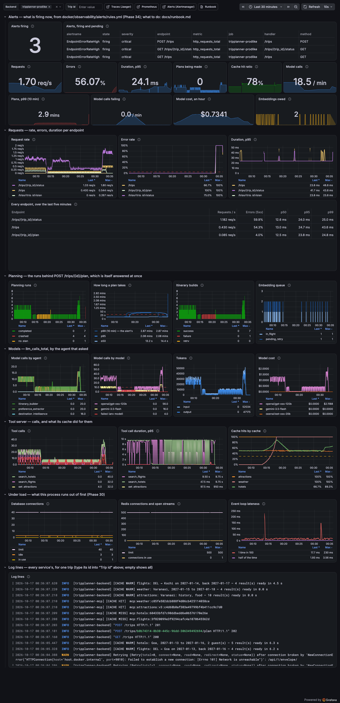

# Phase 34 — Advanced Monitoring & Alerts

**Status: built, and every alert made to fire for real — on this machine, on the load test's stack with stand-ins for every model and provider, watched by the observability stack of Phase 29 with Alertmanager added. NOT on a deployment: there is none yet.** What that leaves open is in [Known limits](#known-limits).
**What the phase delivers (roadmap):** Alerts fire on real anomalies. On-call runbook exists.

Decisions: `DECISIONS.md` #297–#314. How to run it: `HOW_TO_RUN.md`, Step 32. The runbook: [`docs/runbook.md`](runbook.md).

Four things are worth knowing before reading on.

- **Each of the four alerts fired twice over: from series written by hand, and on the running stack.** `promtool test rules` fires each rule at the minute its `for:` allows and compares the whole message; `scripts/alert_drill.py` broke, on the stack, the thing each alert is about — the builder's model, the pooler, the cache, the short-prompt models — and followed the alert from pending to firing, to the receiver, to resolved. In the final run all four did, and in twelve minutes of ordinary traffic before them nothing fired, or was even pending. The final run, on the tree as committed: **5 of 5 as expected**, 00:01–01:02 on 17 October, the machine awake throughout (`docs/alerts/final/`).
- **The drill found two things nobody had asked it about.** Its quiet minutes found that the cache alert's floor counted the previous process's lookups after a restart (#300) — the alert went pending on a backend's first few misses. And the errors drill passed while its own record said every request had been a **500**: a pooler that is gone is a database whose name does not resolve, and the app had never met `socket.gaierror` (#311). Both fixed, both held by tests that fail on the code as it was.
- **"P99 latency of POST /trips/{id}/plan" is the plan's.** The request answers 202 in milliseconds; the alert is on the plan it starts (#298).
- **Nothing leaves this machine.** Alerts go to a stand-in receiver that prints them; where they would go for a deployment (Slack, a pager) is a file and a URL that only the user can create (HOW_TO_RUN Step 32 E).

## What was built

```
docker/observability/alerts/rules.yml      ← NEW: the four alerts — condition, `for:`, labels, a message that runs its own queries
docker/observability/alerts/tests.yml      ← NEW: promtool's tests — each alert fired on purpose, and kept quiet where it must be
docker/observability/alertmanager.yml      ← NEW: grouped by alert and backend, said again every 4 h, resolved said too; where
                                             a deployment's Slack would go, as a comment
docker/observability/compose.yml           ← Alertmanager 0.34.1, the alert receiver; Prometheus mounts the rules
docker/observability/prometheus.yml        ← rule_files, alerting → alertmanager:9093
docker/observability/grafana/dashboards/   ← an alerts row on top; the four alerts' measures, model cost, the embeddings owed;
  tripplanner.json                           the alerts' thresholds drawn as dashed lines; the embedding queue, model cost
scripts/alert_receiver.py                  ← NEW: a stand-in for where alerts go — prints each, keeps them at GET /alerts
scripts/alert_drill.py                     ← NEW: each alert made to fire on the load test's stack, and quiet minutes first
scripts/observability.py                   ← waits for Alertmanager and the receiver too
scripts/observability_check.py             ← 8. the four rules evaluated, Alertmanager known, nothing firing; 9. the deep check
scripts/trace_receiver.py                  ← answers GET /api/v1/sessions, as LangSmith does (the deep check asks it)
src/backend/app/core/deep_health.py        ← NEW: Postgres, Redis, the tool server, LangSmith — each with a deadline, together
src/backend/app/api/routes/admin.py        ← GET /admin/health-deep; the embedding backlog as one function, for the gauge too
src/backend/app/api/deps.py                ← may_check_health: the same people as GET /metrics
src/backend/app/main.py                    ← the embedding queue counted every 15 s; an OSError may be the database away
src/backend/app/db/errors.py               ← a name that does not resolve, a network with no route: the database is away (#311)
src/backend/app/preflight.py               ← no OPS_TOKEN: the deep check answers nobody either
src/telemetry/metrics.py                   ← embedding_queue_depth{state}; mcp_cache_window_lookups (the cache alert's floor)
.github/workflows/ci.yml                   ← promtool check, promtool test, amtool check-config — on every push
docs/runbook.md                            ← NEW: what to do when each alert arrives
docs/alerts/                               ← NEW: every drill's record — the first run, and the final one
tests/unit/test_phase34_alerts.py          ← NEW
tests/unit/test_phase34_health.py          ← NEW
tests/integration/test_phase34_health_integration.py  ← NEW
```

## Dev A — the alert rules

| The roadmap asks | What was built | Seen |
|---|---|---|
| P99 latency for `POST /trips/{id}/plan` over 30 s → alert | `PlanLatencyHigh`: p99 of `planning_run_duration_seconds{kind="plan"}` over 10 minutes > 30, for 5m (#298). The message: how many plans, how many over 30 s, how they ended | the builder's model silent: pending 42 s after, **firing 340 s after**, delivered at 351 s — *"plans take 44.59s at p99 … Plans in the last 10 min: 44, of which over 30s: 16. How they ended: completed 28; no_plan 16"*; resolved 637 s after it was mended |
| Error rate of any endpoint over 5% over 5 minutes → alert | `EndpointErrorRateHigh`: 5xx ÷ all, per `method` + `handler`, over 5m, > 0.05, for 2m; probes left out (#299). The message: how many requests and how many failed, every endpoint failing now, what 503 and 500 mean here | the pooler stopped: pending 11 s after, **firing 128 s after**, delivered at 140 s — *"GET /trips/{trip_id}/status — 56.73% of its requests failed … 338 requests, of which 5xx: 192. Every endpoint failing now: GET /trips/{trip_id}/status 56.73%; GET /trips 53.13%; POST /trips 53.13%"*; every request a 503; resolved 290 s after |
| `mcp_cache_hit_ratio` below 0.3 → alert | `CacheHitRatioLow`: the gauge < 0.3, of at least 10 lookups in its own window (`mcp_cache_window_lookups`, #300), for 3m. The message: the lookups by cache and result, and what an error and a miss each mean | the cache emptied every half second: pending 143 s after, **firing 325 s after**, delivered at 336 s — *"answered 0% of lookups … of 423 lookups. By cache: attractions miss 101; geocode miss 101; hotels miss 100; flights miss 75; weather miss 51"*; resolved 197 s after |
| `llm_calls_total{status="error"}` over 10 a minute → alert | `ModelErrorRateHigh`: failed calls a minute over 5m > 10, every agent and model together, for 2m (#301). The message: which agent → model, how many, what share of all calls | both short-prompt models answering 429: pending 138 s after, **firing 254 s after**, delivered at 266 s — *"20.1 model calls a minute are failing … intent_parsing → gemini-3.5-flash 50; intent_parsing → openai/gpt-oss-20b 50. Of all calls: 34.74% failed"*; every plan still made; resolved 186 s after |
| Test each alert by deliberately triggering the condition | promtool (10 tests, every alert firing with its whole message and kept quiet) and the drill on the running stack (#313) | promtool: SUCCESS. The drill, final run: 5 of 5 — and twelve quiet minutes before it in which nothing fired or was pending |
| **Acceptance:** all 4 fire correctly under deliberate test conditions; messages say which endpoint, which metric, current vs. threshold | — | every delivered message named its endpoint or metric, its value and the threshold, the counts behind it, and its runbook section — the drill refuses one that does not |

## Dev B — the runbook, the dashboard, the deep health check

| The roadmap asks | What was built | Seen |
|---|---|---|
| `docs/runbook.md`: per alert, what to check first, which logs and traces, common causes, known fixes | One section per alert — what it means, what the message says, check first (in order, with the queries), common causes (this app's own, from Phases 29–32 and this phase's drills), known fixes, when it resolves; where to look, how to read the deep check, how to silence, and what no alert can see | each alert's `runbook_url` opens its section (a test holds every link to a heading) |
| `GET /admin/health-deep`: `SELECT 1`, Redis ping, `estimate_budget` through the tool server, LangSmith — a JSON object per dependency | `app/core/deep_health.py`: each with its own deadline, all at once; `ok` / `degraded` / `failing` (503); `off` for LangSmith not set up; the operator's (#305–#307) | dev backend, real keys: all `ok` in 446 ms, LangSmith's key accepted; Redis stopped → 503 in 0.7 s, `redis: ConnectionError: Error 61 …`; the stack with its pooler stopped → `postgres: gaierror …` |
| Grafana: RED + LLM cost + cache hit ratio + embedding queue on one dashboard | The Phase 29 dashboard with an alerts row on top, a row of the alerts' measures, `Model cost`, `Embedding queue` (`embedding_queue_depth`, #308), and each alert's threshold drawn (#309) | [the picture below](#the-dashboard), taken while `EndpointErrorRateHigh` fired for three endpoints; Phase 29's check: every one of the 31 panels' queries answered without an error, 30 with data after a real plan (the 31st is the alerts table, empty while nothing fires) |
| **Acceptance:** runbook covers all 4; health-deep correct for every dependency; the dashboard shows real data without errors | — | ✅ all three — below |

## Found and fixed along the way

**The cache alert's floor counted lookups its ratio did not** (#300). The quiet drill's first minute: twenty seconds after the drill restarted the backend, `CacheHitRatioLow` went pending at a ratio of 0.21. The ratio is the new process's — a handful of warming misses, no plan yet to hit them; the floor, `increase(mcp_cache_lookups_total[5m]) >= 10`, was the counter's, which still held the 330 lookups of the process before. `for: 3m` kept it from firing, but a deploy followed by a trip created and left unplanned for three minutes would have paged somebody. The app now exports the window's own lookup count and the floor is that. A promtool test reproduces the restart at 15-second resolution: it fires with the old floor and not with this one — the first version of that test, at one sample a minute, passed with both, because at that resolution the old lookups leave the window before `for:` is up.

**A pooler that is gone was a 500** (#311). The errors drill passed — the alert fired — and its record said `{"list": {"500": 37}, "create": {"500": 37}}`. The backend's log in Loki said why: `socket.gaierror: [Errno -2] Name or service not known`, raised by asyncpg unwrapped, and "The run of trip … ended and could not be marked: gaierror". Phase 32 had stopped Postgres behind a pooler that stayed up; nobody had stopped the pooler. Fixed in the classifier and the handler; the final run's errors drill was made on the fixed image.

**Phase 27's deliberate error paged somebody.** Running Phase 27's check on the production-like stack after the final drill, the receiver printed `▲ FIRING EndpointErrorRateHigh · critical · … · GET /admin/sentry-test` — "Requests in the last 5 min: 2, of which 5xx: 1". The route exists to fail, so that error reporting can be seen to work; it is now left out with the probes (#299). A promtool test has it beside the others and fires with the old rule; on the stack, three deliberate 500s in five minutes then fired nothing for three minutes. The drills' records are unaffected — none of them asks that route.

**The bucket the message counts from was labelled `30.0`, not `30`** (#312) — read from the running Prometheus before anything fired; the first rule and its tests would both have been wrong together.

**A five-minute rate needs five minutes.** promtool showed the model alert still pending at six minutes where `for: 2m` had led me to expect firing at three: the rate of a counter that has just begun failing climbs for five minutes. How long it takes to cross 10 a minute depends on how far over it the failures are (#303); I had first written "about six minutes" into the decision and a test's comment, and the drill — firing 259 s after the models began refusing, at 20 a minute — showed that was one case, not the rule.

**What my break-on-purpose checks found in my tests.** Of the first pass's 58 breakages, 53 were caught. Two were mine (one changed nothing; one matched two places), three were real: the integration test of the embedding queue had no embedded itinerary, so counting every row and counting the owed ones gave the same 2; the window test always asked for the ratio before the floor, and the ratio trims the window for both; nothing tested that the check script asks sections 8 and 9. Each got a test that fails on the breakage.

**A test that passed only with my `.env`** — the deep check's tests read `LANGCHAIN_API_KEY` from whatever the settings held, and mine has one. Every setting the tests read is now set in the test.

## The order things were done in

Times from `date` in the commands that ran each step, the records' own `began`, and the files' modification times.

| When (IST) | What |
|---|---|
| 16 Oct 22:34 | Begun: main at the Phase 33 merge (`b312dff`); battery 60 %, on battery |
| 22:49 | The load test's stack (`chaos.py up`) and the observability stack with Alertmanager and the receiver |
| 22:54 | The rules' first promtool pass; `le="30.0"` read from the running Prometheus and the rule corrected |
| 22:54–23:56 | **The first drill run, all five** (`docs/alerts/first/`): the quiet minutes found the cache floor (23:07) |
| 23:07–23:20 | The cache floor fixed, with its restart test; the first pass of the break-on-purpose checks: 53 of 58 |
| 23:24 | The integration suite: 82 passed |
| 23:45 | The deep check on the dev backend with Redis stopped and started |
| 23:57 | The stack rebuilt from the tree; the first run's errors record read: 500s — the DNS fix (#311) |
| 17 Oct 00:00 | The stack rebuilt again, the fix checked on it (`GET /trips` → 503 with the pooler stopped) |
| 00:01–01:02 | **The final drill run, all five** (`docs/alerts/final/`): 5 of 5 |
| 01:03–01:04 | The production-like stack, real keys: Phase 29's check (58 passed), Phase 27's (25 passed, 1 skipped) — one real plan each |
| 01:03–01:06 | The break-on-purpose checks, the whole set again after the drill's fixes: **61 of 61** |
| 01:06 | **`EndpointErrorRateHigh` fired for `GET /admin/sentry-test`** — Phase 27's deliberate error; left out of the rule |
| 01:06–01:08 | The browser suite: 60 passed |
| 01:09–01:12 | The deliberate error made three times on the stack with the fixed rule: nothing fired |
| 01:13–01:17 | The break-on-purpose checks once more, after that last change to the rule: **62 of 62** |

## Live results

### promtool and amtool

```
docker run --rm -v "$PWD/docker/observability:/w:ro" --entrypoint promtool prom/prometheus:v3.15.0 test rules /w/alerts/tests.yml
  SUCCESS
```

10 tests, 18 evaluations: every alert firing with its whole message (and still firing where its window says it must be), pending where its `for:` holds it, and quiet for plans of up to 30 s and slow refinements, for 4xx and probes and exactly 5 %, for a few lookups after a restart and a ratio of nothing, for exactly 10 failed calls a minute and fifty that worked.

### The drills

`python scripts/alert_drill.py all --label final`, 17 October 00:01–01:02, on the load test's stack built from this tree (version 0.34.0), every record saying `asleep_s: 0`. Seconds are from the moment the thing was broken; "resolved" from the moment it was mended.

| Drill | What was broken | Alert | Pending | Firing | Delivered | Resolved | Meanwhile |
|---|---|---|---|---|---|---|---|
| quiet | nothing — 118 plans over 12 minutes, all completed in 10–14 s | none may | — | — | — | — | nearest: plans' p99 15.3 s (of 30); no 5xx; the cache's lowest ratio of at least 10 lookups 0.52 (of 0.3) — 0.29 at 17 s after the restart, of 7 lookups, under the floor; no failed model call |
| slow-plans | the builder's model never answers (Phase 31's fault) | PlanLatencyHigh | 42 s | 340 s | 351 s | 637 s | 17 of 18 plans failed, at 36 s (the builder's deadline); the deep check `ok` — it does not ask models |
| errors | the pooler's container stopped | EndpointErrorRateHigh | 11 s | 128 s | 140 s | 290 s | every request 503; the deep check 503, `postgres: gaierror: [Errno -2] Name or service not known`; `PlanLatencyHigh` pending at 250 s (#311) |
| cache | `mcp:*` deleted every half second (881 entries) | CacheHitRatioLow | 143 s | 325 s | 336 s | 197 s | every lookup a miss; plans 22 s at the median instead of 12 — the providers asked every time; the deep check `ok` |
| model-errors | Gemini and Groq's small model answer 429 | ModelErrorRateHigh | 138 s | 254 s | 266 s | 186 s | 20.6 failed calls a minute; every plan made (intent parsing failed both ways; the plan was made from the trip's fields) |

Each alert reached the receiver once firing and once resolved. What it printed (`docs/alerts/final/drill.log`):

```
▲ FIRING   EndpointErrorRateHigh · critical · tripplanner-prodlike · GET /trips/{trip_id}/status
           GET /trips/{trip_id}/status — 56.73% of its requests failed over the last 5 minutes; the threshold is 5%.
           Metric: http_requests_total{status="5xx"} ÷ all requests to GET /trips/{trip_id}/status, over 5m.
           Now: 56.73% · threshold: 5% · backend: tripplanner-prodlike.
           Requests in the last 5 min: 338, of which 5xx: 192.
           Every endpoint failing now: GET /trips/{trip_id}/status 56.73%; GET /trips 53.13%; POST /trips 53.13%;
           503 = Postgres or Redis cannot be reached (the log says which); 500 = a bug, in Sentry. Look first: GET /admin/health-deep, then the log lines with "could not be served".
           Runbook: https://github.com/shauryaman28/tripplanner-ai/blob/main/docs/runbook.md#endpointerrorratehigh

▲ FIRING   CacheHitRatioLow · warning · tripplanner-prodlike · mcp_cache_hit_ratio
           The tool server's cache answered 0% of lookups over the last 5 minutes; the threshold is 30%.
           Metric: mcp_cache_hit_ratio (hits ÷ lookups over 5m, this process: host.docker.internal:8200), of 423 lookups.
           Now: 0% · threshold: 30% · backend: tripplanner-prodlike.
           By cache, over 5m: attractions miss 101; geocode miss 101; hotels miss 100; flights miss 75; weather miss 51;
           …
```

**The first run** (16 October 22:54–23:56, `docs/alerts/first/`, the app and the rules as they were before the two fixes) was 4 of 5: the four alerts fired, delivered and resolved within fifteen seconds of these times, and the quiet run failed — `CacheHitRatioLow` pending at 0.21, twenty seconds after the restart (#300). Its errors record is the one with every request a 500 (#311).

### GET /admin/health-deep

The dev backend on real keys (`uvicorn` on :8000, `.env` as it is):

```
{"status": "ok", "took_ms": 446.4, "dependencies": {
  "postgres":    {"status": "ok", "latency_ms": 14.1,  "detail": "SELECT 1 answered"},
  "redis":       {"status": "ok", "latency_ms": 12.0,  "detail": "PING answered"},
  "tool_server": {"status": "ok", "latency_ms": 294.8, "detail": "estimate_budget answered: ₹27,500 for the test trip"},
  "langsmith":   {"status": "ok", "latency_ms": 446.1, "detail": "the key is accepted · tracing off (LANGCHAIN_TRACING_V2 is not true)"}}}
```

The tool server’s 295 ms includes the process being started by the check; asked again once it ran, 25 ms. With the dev Redis stopped (`docker stop tripplanner_redis`): HTTP 503 in 0.71 s, `"status": "failing"`, `redis: ConnectionError: Error 61 connecting to localhost:6379. Connection refused.`, the other three asked and `ok`; Redis started again → 200, all `ok`. On the stack, with its pooler stopped: 503, `postgres: gaierror: [Errno -2] Name or service not known`, Redis and the tool server `ok`, LangSmith `off` (the stack has no key).

### The dashboard



Rendered headless at 1600 px during the final run's errors drill (Playwright's Chromium against Grafana, the panels given time to answer). Top: three alerts firing, each row naming its endpoint and metric; the errors tile at 56 %. The error-rate chart at 100 % for three endpoints above its dashed 5 % line; "How long a plan takes" with the alert's own p99 and its dashed 30 s; the plans' p99 at 2.9 minutes from the slow-plans drill before and the outage's runs (#311); the embedding queue with one owed; the model cost. An earlier render, of the whole page scrolled, showed the alerts table empty while one alert fired: the table had not been drawn yet when the picture was taken — opened on its own it listed the alert, and a taller window that needs no scrolling draws every panel.

### Phase 29's check on the production-like stack

`python scripts/observability_check.py --prodlike` — the image that is deployed, rebuilt from this tree (0.34.0), real providers and models, one real plan (23.7 s): **58 passed, 0 failed**. Its two new sections:

```
8. Alerts: the four rules, evaluated, handed to Alertmanager — and quiet while nothing is wrong
  ✓ Prometheus has the four alerts  — CacheHitRatioLow, EndpointErrorRateHigh, ModelErrorRateHigh, PlanLatencyHigh
  ✓ each is evaluated without an error  — health ok
  ✓ Prometheus sends what fires to Alertmanager  — http://alertmanager:9093/api/v2/alerts
  ✓ Alertmanager knows where to send it  — stand-in
  ✓ nothing fires for this backend — after a healthy plan  — job tripplanner-prodlike

9. GET /admin/health-deep: every dependency asked to do its work  (http://localhost:8200)
  ✓ it answers, and says the app can work  — HTTP 200, ok in 32.4 ms
  ✓ postgres: SELECT 1 answered  — 5.8 ms
  ✓ redis: PING answered  — 3.6 ms
  ✓ tool_server: estimate_budget answered: ₹27,500 for the test trip  — 32.2 ms
  ✓ langsmith: off — no LANGCHAIN_API_KEY: traces are not sent
  ✓ …and to nobody without the operations token  — HTTP 404
```

and Phase 29's own — one trace of 102 spans across both processes, no orphan, 43 log lines for the trip — as before. Phase 27's `python scripts/prod_check.py --prodlike` on the same image: **25 passed, 0 failed, 1 skipped** (the frontend, not started) — a real plan over the stream in 9.9 s, the deliberate error at the Sentry stand-in, nothing secret in it.

## Tests

**1,455 unit + contract, 83 integration, 60 browser — all passing.** New in this phase: 90 unit, 4 integration.

- **`tests/unit/test_phase34_alerts.py` (44)** — the rules against the roadmap (four alerts, each on its metric at its threshold, `kind="plan"`, 30 s a bucket edge of the histogram), against the app (every metric a rule or its message reads is one the app exports, the probes left out are the app's routes), and against the runbook (every `runbook_url` a heading, each section with what to check and what fixes it). promtool and amtool themselves, through Docker or on the PATH. The cache floor and the ratio counting the same lookups. Alertmanager to the receiver, grouped, resolved said; Prometheus to Alertmanager; the images pinned, the receiver on the app's own base image; CI running all three tools. The dashboard: the roadmap's panels, the alerts first, the thresholds drawn equal to the rules', no panel over another. The receiver over HTTP. The drill's judgement of a message, its measures, its counts, its watch. The check script's sections 8 and 9, saying yes and saying no.
- **`tests/unit/test_phase34_health.py` (46)** — every dependency working (the real tool server, in memory); Postgres away, answering wrong, hanging; Redis away, silent, never made; the tool server unreachable or answering nonsense; LangSmith refusing the key, unreachable, not set up (and then never called); the checks together, not one after another; who may ask, in eight cases; nothing secret in an answer or the log; the pre-start check's warning; the embedding queue counted, NaN when it cannot be, the same numbers as `/admin/embedding-health`, started and stopped with the app. And #311: a name that does not resolve and a network with no route are the database being away, any other `OSError` is not, a request is told 503, a run goes on trying to mark its trip.
- **`tests/integration/test_phase34_health_integration.py` (4)** — the deep check on real Postgres and Redis and a tool server started as a process of its own; Redis gone → 503 with the others still asked; the embedding queue counted from real rows; and the real driver asked for a connection to a `.invalid` name.
- Changed: `test_phase28_pipeline.py` (CI has a fifth step), `test_phase29_stack.py` (seven programs, not five).

## Break it on purpose

62 deliberate breakages, each applied to a scratch copy of the repository with a database and a Redis number of its own; the Phase 34 unit tests (and Phases 28–29's that read the same files) run on it, and the integration tests when a breakage says so. **First pass, 53 of 58 caught; the whole set again after the drill's fixes: 61 of 61; and once more after the last change to a rule, on the tree as committed: 62 of 62** — 61 by the unit tests, one only by the integration test (counting every embedding row instead of the owed ones).

| Where | Breakages | For example |
|---|---|---|
| the rules | 24 | the threshold 30 → 45, 5 % → 10 %, 0.3 → 0.35, 10 → 12 · every kind of run, not only POST /plan's · a five-minute window for the plans · p95 for p99 · `for: 5m` → `1m` · 4xx counted · `/ready` counted · the deliberate error counted · every endpoint together · `<` as `<=` · no floor, a floor of 1, the counter's floor as it was · a second, not a minute · every call, not the failed ones · `le="30"` · the runs' kind for how they ended · no runbook link, a link to no heading · the threshold out of the summary |
| where it goes | 8 | resolved not sent · the receiver's port · grouped by alert only · the rules not loaded, not mounted · no Alertmanager · Alertmanager at `latest` · CI not running the tests |
| the receiver and the drill | 5 | the message not printed · state ignored · a notification without alerts taken · a message without a threshold passing · a value that moves counted as a change |
| the deep check | 13 | no deadline · one after another · `off` as failing · LangSmith required · a refused key fine · LangSmith asked from the test stacks · a tool error taken for an answer · `degraded` when something required fails · not scrubbed · nothing in the log · 200 when failing · anyone may ask (route, guard) |
| the embedding queue and the floor | 6 | not known counted as empty · stops at the first failure · never counted · the wrong rows · the floor counting hits · the floor never trimmed |
| #311 | 3 | a name that does not resolve · no route · the `OSError` handler gone |
| the dashboard and the check script | 3 | the queue's metric renamed · a threshold drawn that is not the alert's · section 8 not asked |

What the first pass's survivors were is under [Found and fixed](#found-and-fixed-along-the-way).

## Done criterion checklist

| | Criterion | |
|---|---|---|
| ✅ | Alert: P99 latency for `POST /trips/{id}/plan` over 30 s | `PlanLatencyHigh` — the plan's p99 (#298); fired in promtool and on the stack |
| ✅ | Alert: error rate for any endpoint over 5 % over 5 minutes | `EndpointErrorRateHigh` — per endpoint, 5xx; fired for three endpoints at once on the stack |
| ✅ | Alert: `mcp_cache_hit_ratio` below 0.3 | `CacheHitRatioLow` — with a floor of its own lookups (#300) |
| ✅ | Alert: `llm_calls_total{status="error"}` over 10 a minute | `ModelErrorRateHigh` — 20.6 a minute on the stack |
| ✅ | All 4 fire correctly under deliberate test conditions | promtool: SUCCESS; the drill: 5 of 5, quiet included |
| ✅ | Messages say which endpoint, which metric, current vs. threshold | every delivered message, checked by the drill; whole messages compared by promtool |
| ✅ | Runbook covers all 4 alert conditions | `docs/runbook.md`; every alert links to its section |
| ✅ | `GET /admin/health-deep` returns correct status for every dependency | unit, integration; live: all `ok`, Redis stopped → 503, the pooler stopped → 503 `postgres` |
| ✅ | Grafana dashboard shows real data without errors | 31 panels answered without an error, 30 with data after a real plan; the picture |
| ◻ | …on a deployment | there is none (Known limits) |

✅ seen on this machine · ◻ not possible yet

## Known limits

- **Not on a deployment.** The alerts, Alertmanager and the receiver run on this machine; a deployment needs a Prometheus that can read it (Step 27 D), an Alertmanager, and somewhere to send alerts — a Slack webhook or a pager (Step 32 E). None exists.
- **A backend Prometheus cannot read alerts nobody** (#314). The platform's health check on `/ready` is what stands in for that.
- **One slow plan on a quiet evening can fire `PlanLatencyHigh`.** At this app's traffic a ten-minute p99 is the slowest plan or two; the message says how many plans there were and how many were slow, and the runbook's first step is to read that.
- **The cache alert is per process.** `mcp_cache_hit_ratio` and its floor are one backend's; with several instances each alerts on its own, and the counter beside them adds up correctly across them (the dashboard's per-cache chart uses it).
- **The model alert does not tell a fallback that worked from a plan that failed.** Gemini refused and Groq answered is two calls, one failed; the message lists which agents and models, and the runbook says which of them have a fallback.
- **Alert messages link to Grafana on localhost** (`dashboard` annotation) and to the runbook on GitHub's `main` — right on this machine and for anyone with the repository; a deployment's Grafana would need its own address there.
- **The deep check does not ask the models.** Each call would spend quota; a model that is slow or failing is the dashboard's and `ModelErrorRateHigh`'s to show. With the builder's model silent (the slow-plans drill) it said `ok` to everything — which was true of what it asks.
- **The receiver keeps alerts in memory**: restarting it forgets them (Alertmanager does not send them again unless they are still firing at its next repeat).
